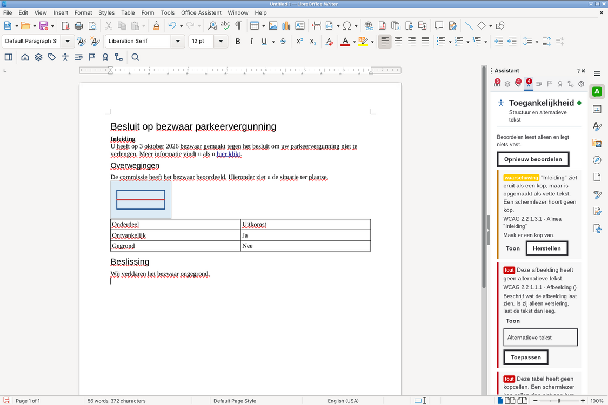
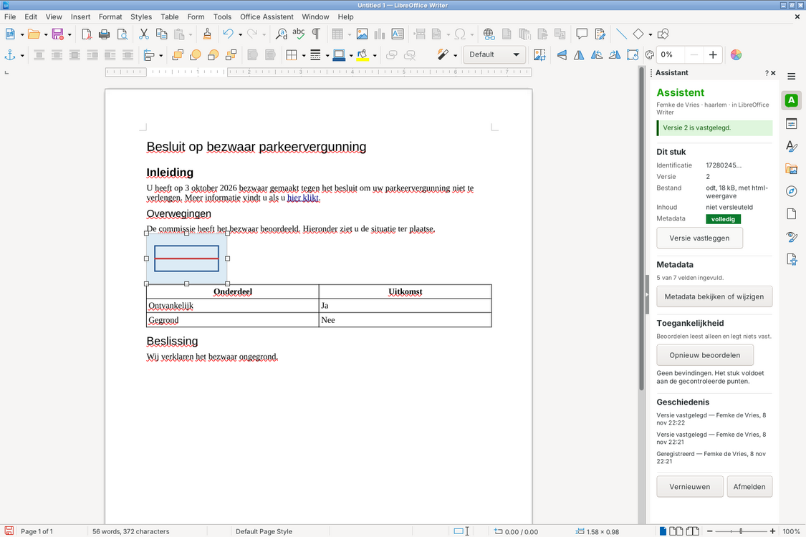

# oa-adapters

**Adapters per werkomgeving** voor de Office Assistent. Een adapter is de dunne schakel tussen één werkomgeving en de assistent: levert de inhoud, neemt haar terug en zegt wat de omgeving kan. Hij heeft geen sleutels, geen tokens en geen gegevens. Het paneel is in elke werkomgeving hetzelfde.

> Onderdeel van het werkende prototype van de Office Assistent. Een prototype, geen product.

## Werkomgevingen

| Werkomgeving | Adapter | Vermogens | Pagina |
|---|---|---|---|
| Demo-tekstverwerker | `DemoEditorAdapter` (rijk of beperkt) | alle, of alleen de drie basisvermogens | `/werkomgeving` |
| Microsoft Word, ook Word voor het web | `StructuurAdapter` + `WordTekstverwerker` (Office.js, WordApi 1.3) | basis, segment-vervangen, plek-tonen, afdruk-schrijven, tekst-vervangen, selectie-lezen | `/word/taskpane.html`, manifest op `/word/manifest.xml` |
| Microsoft Excel, ook Excel voor het web | `ExcelAdapter` (Office.js, ExcelApi 1.9) | basis, segment-vervangen, plek-tonen, afdruk-schrijven, bestand-opleveren, tekst-vervangen, selectie-lezen | zelfde takenvenster en manifest |
| Microsoft PowerPoint, ook PowerPoint voor het web | `PowerPointAdapter` (Office.js, PowerPointApi 1.4; titels 1.8, alternatieve tekst 1.10) | basis, segment-vervangen, plek-tonen, afdruk-schrijven, bestand-opleveren, tekst-vervangen, selectie-lezen | zelfde takenvenster en manifest |
| LibreOffice Writer, Calc en Impress op de eigen computer | zijpaneel in Writer (Python, zelfde regels als `semantisch.ts` en `oa-kern`); of het paneel in de browser via `StructuurAdapter` + `LibreOfficeTekstverwerker` | basis, segment-vervangen, plek-tonen, afdruk-schrijven, bestand-opleveren, tekst-vervangen, selectie-lezen | zijbalk **Assistent**; `/libreoffice` |
| Collabora Online | `CollaboraAdapter` (postMessage en WOPI) | basis, afdruk-schrijven, tekst-vervangen; voor ods en odp ook segment-vervangen | `/collabora` |

**Anonimiseren bij de bron** gebruikt `tekst-vervangen` (persoonsgegevens als heel woord vervangen door hun plaatshouder) en `selectie-lezen` (tekst die de medewerker in het document selecteert). Hoe elke werkomgeving dat doet staat in de CHANGELOG (0.10.0). Collabora kan de selectie niet doorgeven; daar voeg je toe via het voorbeeld in het paneel.

Collabora laat zien hoe de assistent terugvalt: deelvervangen kan daar niet, dus vervangt hij het hele document en laadt het opnieuw.

## Hoe Word en LibreOffice werken

Word en LibreOffice beschrijven een document als alinea's met een stijl, lijsten, tabellen, afbeeldingen en links. De adapter leest die structuur als **blokken** (`src/semantisch.ts`) en maakt er semantische html van; daar werken de assistent-services mee. Een herstelling komt terug als html-segment; `segmentNaarOpdracht` maakt daar een **opdracht** van die de tekstverwerker zelf uitvoert:

| Bevinding | Opdracht in Word en LibreOffice |
|---|---|
| Vette tekst die een kop is; overgeslagen kopniveau | Kopstijl zetten (Heading N) |
| Tabel zonder kopcellen | Eerste rij als kopregel (Word: headerRowCount; Writer: "kop herhalen") |
| Afbeelding zonder alternatieve tekst | Alternatieve tekst van de afbeelding |
| Vage linktekst | Linktekst vervangen, adres blijft |

Zo blijft de opmaak van het document staan. Voor elke opdracht controleert de adapter of de alinea nog dezelfde tekst heeft; is het document intussen gewijzigd, dan vraagt hij om opnieuw te beoordelen.

### Word

Een invoegtoepassing met een takenvenster. In Word voor het web staat dat venster in een iframe van office.com; daar komt het cookie van de integratielaag niet aan. Het inloggen gebeurt daarom in een apart venster van Office (`/word/aanmelden.html`), dat na het inloggen een sessiesleutel aan het takenvenster geeft; die gaat als `Authorization`-kop mee, alleen in het geheugen.

Hetzelfde manifest en takenvenster werken in **Excel** en **PowerPoint**; het takenvenster kiest de adapter bij het programma (`src/office/`). Een rekenblad en een presentatie gaan als secties naar de assistent, net als in LibreOffice en Collabora: per blad de naam als kop, het gebruikte bereik als tabel en afbeeldingen; per dia de titel als kop, tekstvakken en afbeeldingen. Herstellen: een blad hernoemen, een titel wijzigen of (als een dia er geen heeft) een tekstvak "Titel" toevoegen, alternatieve tekst. De afdruk staat in de instellingen van de invoegtoepassing, die Office in het bestand bewaart. Wat Office.js niet kan, zegt het paneel: de alternatieve tekst van een grafiek in Excel, en in oudere PowerPoint-versies de alternatieve tekst van afbeeldingen.

### LibreOffice

`libreoffice-extensie/` is een Python-extensie (`.oxt`). De assistent staat als tabblad **Assistent** in de zijbalk van Writer, Calc en Impress, op twee manieren. De werkbalk **Assistent** heeft dezelfde knoppen als de demo: Paneel, de modules en Beoordelen; een knop opent de zijbalk op die module.

**Het webpaneel van de server (standaard, optie 1).** Zoals MIRA het beschrijft: één paneel, in elke werkomgeving hetzelfde. De extensie hangt een WebKitGTK-webweergave in het vlak van het zijpaneel (`pythonpath/oa_webview.py`). Daarin draait hetzelfde React-paneel als in de browser en in Word, van `/libreoffice` op de integratielaag. Inloggen gaat in de webweergave zelf (cookie, eigen opslag in `~/.local/share/office-assistent`).

- Het document bereikt het paneel via de lokale brug (`pythonpath/oa_brug.py`). In de webweergave gaat dat niet over http: een https-pagina mag geen http naar `127.0.0.1`. WebKit biedt daar een berichtkanaal (`window.webkit.messageHandlers.oaBrug`), alleen voor pagina's van de eigen integratielaag en met de sleutel van de brug; `src/libreoffice/tekstverwerker.ts` kiest dat kanaal vanzelf.
- Toetsen: LibreOffice geeft toetsaanslagen aan het GTK-onderdeel met de focus; een klik in het paneel geeft de webweergave de focus, een klik in het document geeft hem terug.
- Kan nu op **Linux** met de GTK-weergave van LibreOffice (Ubuntu, Debian, Fedora), met `python3-gi` en `gir1.2-webkit2-4.1`. Getest op X11. De webweergave zit in hetzelfde proces en het vlak wordt gevonden aan zijn plaats in de zijbalk; er zit niets X11-specifieks in, dus naar verwachting werkt het ook op Wayland. Dat is niet getest.
- **Windows en macOS: nog niet.** Daar valt het zijpaneel terug op het eigen paneel. Windows kan later met WebView2, zoals de Outlook-adapter in MIRA.



**Het eigen paneel van LibreOffice (alternatief, optie 2).** Gebouwd met de eigen schermelementen van LibreOffice (`pythonpath/oa_zijpaneel.py`), met dezelfde functies. Stabieler (geen webweergave nodig, werkt overal waar LibreOffice werkt), maar een tweede gebruikersinterface om te onderhouden. Kiezen: **Office Assistent → Zijpaneel: webpaneel van de server** of **Zijpaneel: eigen paneel van LibreOffice** (per gebruiker, in `~/.config/office-assistent/voorkeur.json`); een gemeente kan de standaard zetten met `"paneel": "eigen"` in `instellingen.json`. Kan de webweergave niet, dan zegt het eigen paneel dat erbij.

- `oa_kern.py` bevat de regels van `oa-kern` (metadateren, herstellen) en `src/semantisch.ts` in Python. `test/test_kern.py` vergelijkt beide op dezelfde voorbeelden (`test/kruis.json`).
- `oa_paneelmodel.py` is wat het eigen paneel weet en doet, zonder UNO; `oa_verbinding.py` praat met de integratielaag met de sessie als `Authorization: Bearer`. Aanmelden gaat één keer via de browser (`/libreoffice#aanmelden=…`, de sessie van `/api/auth/koppel` naar een eenmalige server op `127.0.0.1`).



Beide zijn getest in een echte LibreOffice 24.2 op een virtueel scherm (GTK; het eigen paneel ook X11): registreren, beoordelen, tonen, herstellen (kop, alternatieve tekst, kopregel), versie vastleggen; het webpaneel ook over https.

**Het paneel in de browser.** **Office Assistent → Assistent in de browser openen** start een kleine webserver op `127.0.0.1` en opent het paneel in de browser, met poort en sleutel na het `#` in het adres. De brug antwoordt alleen met die sleutel, alleen aan het adres van de eigen integratielaag, en alleen over dat ene document; elke bewerking loopt via de hoofdthread van LibreOffice.

De integratielaag levert de extensie uit met haar eigen adres erin (`/libreoffice/office-assistent.oxt`).

```
npm run build     # dist/web: alle pagina's, plus dist/web/libreoffice/office-assistent-basis.oxt
npm test          # typecontrole en de tests van semantisch.ts en StructuurAdapter
npm run dev       # ontwikkelserver; /api gaat naar de integratielaag op poort 3000
```

De extensie is getest tegen een echte LibreOffice (headless): start `soffice --headless --accept="socket,host=127.0.0.1,port=2002;urp;"` en draai `python3 -m pytest libreoffice-extensie/test` (de kruistest heeft ook node nodig).

`test/office.test.ts` toetst de Excel- en PowerPoint-adapter tegen een nagebootst Office.js en de echte regels van oa-services.

**Nog niet getest:** de invoegtoepassing in een echte Word, Excel of PowerPoint (Office.js is hier niet te draaien) en Collabora Online zelf (de pagina en de WOPI-host wel, tegen een nagebootste Collabora die met LibreOffice omzet).

## Knoppen in de werkbalk

In elke werkomgeving dezelfde knoppen als in de demo (MIRA): **Paneel**, de modules, **Beoordelen**. Een knop toont het paneel en stuurt het een opdracht (`stuurOpdracht` in oa-paneel).

| Werkomgeving | Hoe |
|---|---|
| Demo-werkomgeving | Een groep in de eigen werkbalk (`src/host/assistentknoppen.ts`). |
| Collabora Online | In de werkbalk van Collabora zelf: postMessage `Insert_Button`, terug `Clicked_Button`. De pictogrammen komen van ons eigen adres (`/iconen/`), zoals Collabora dat eist. Getest tegen een nagebootste Collabora; welke werkbalk een echte Collabora gebruikt (klassiek of het lint), moet blijken. |
| Word, Excel, PowerPoint | Een eigen tabblad **Assistent** in het lint. De knoppen roepen functies aan in het takenvenster, dat in een gedeelde runtime draait (SharedRuntime 1.1). Niet getest. |
| LibreOffice | Werkbalk **Assistent** (`Addons.xcu`, `WriterWindowState.xcu` enz.). Het eigen paneel (optie 2) heeft geen modules; de knoppen tonen dan alleen de zijbalk. |

`scripts/maak-iconen.mjs` maakt de pictogrammen (svg en png) uit dezelfde tekeningen als het paneel.

## Een adapter toevoegen

Implementeer `Adapter` uit `@digitaalgemeengoed/oa-contract` en geef in `werkomgeving()` eerlijk op welke vermogens de omgeving heeft. Alleen de drie basisvermogens zijn verplicht. Heeft de omgeving een structuur zoals Word, implementeer dan `Tekstverwerker` en gebruik `StructuurAdapter`.

## Licentie

© 2026 Gemeente Haarlem. EUPL 1.2, zie `LICENSE`.

Gemaakt door Erik Hoekstra, programma-architect en senior consultant, afdeling i-Ontwikkeling, Gemeente Haarlem, met assistentie van Claude (Anthropic).
